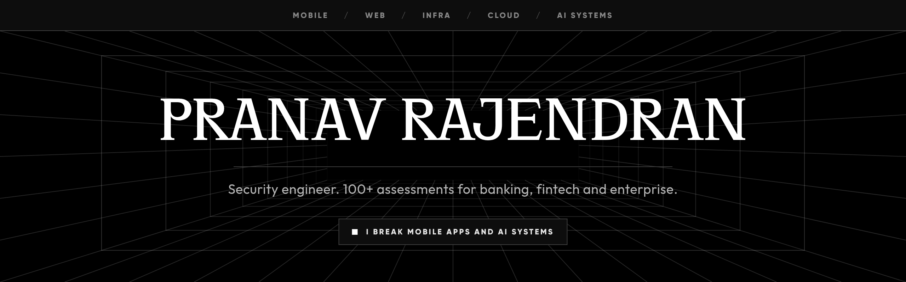

  

  
  
  
  
  

 

I'm a security engineer. Most of my work is breaking things for banks, fintechs and enterprises: mobile apps, web apps, infrastructure and cloud configuration, tested against OWASP and CIS. 100+ assessments so far. Mobile is where I'm deepest. I also do physical red teaming and social engineering, and I audit AI and automation systems.

I'd rather build a tool than wait for one. When the control software for my Linux laptop turned out to be Windows-only, I wrote **strixctl**. When Android 14 broke certificate injection for assessments, I wrote **TrustMeDarling**. Right now I'm building agentic tooling for the repetitive parts of an assessment, from triage to reporting.

 

## Things I've built

| | | |
|:--|:--|:--|
| [**strixctl**](https://github.com/TheKimi7/strixctl) | Battery limit, fan curves and four-zone RGB for ASUS ROG laptops on Linux. GTK3, no daemon, no root at runtime. | `Python` `GTK3` |
| [**TrustMeDarling**](https://github.com/TheKimi7/TrustMeDarling) | Puts user-installed CA certificates into the system trust store on Android 14+, so traffic interception works again. | `Magisk` `Bash` |
| [**SeQueL**](https://github.com/TheKimi7/SeQueL) | sqlite3 on Android test devices, for poking at app databases mid-assessment. | `Magisk` `Bash` |
| **APK Analyzer** in progress | Static analysis of Android APKs that writes up its findings as a vulnerability report, with an LLM doing the drafting. | `Python` `JADX` |

 

## Writing

Notes from real assessments, written for whoever is setting up the same thing next.

- [Rooting an Android Phone with Magisk](https://pranavrajendran.com/blog/rooting-an-android-phone-with-magisk) Sep 2026
- [Building strixctl: Armoury Crate for Linux... (sort of)](https://pranavrajendran.com/blog/building-strixctl) Sep 2026
- [Getting Started with Mobile VAPT: iOS Setup Guide](https://pranavrajendran.com/blog/getting-started-with-ios-vapt) Sep 2025
- [What Are Split APKs and How to Work with Them](https://pranavrajendran.com/blog/what-are-split-apks) Aug 2025
- [Getting Started with Mobile VAPT: Android Setup Guide](https://pranavrajendran.com/blog/getting-started-with-android-vapt) Jul 2025

 

## Toolbox

| | |
|:--|:--|
| **Mobile** | `Frida` `Objection` `Magisk` `LSPosed` `MobSF` `Drozer` `JADX` `APKTool` `ADB` |
| **Web and API** | `Burp Suite` `Postman` `REST` `GraphQL` `JWT` `OAuth 2.0` |
| **Infra and cloud** | `Nmap` `Nessus` `Metasploit` `Wireshark` `AWS` `CIS Benchmarks` |
| **AI and LLM** | `Prompt injection` `Agent tool abuse` `n8n` `OWASP Top 10 for LLMs` |
| **Building** | `Python` `Bash` `JavaScript` `Java` `Kotlin` `Ghidra` `Docker` |
| **Operating systems** | `Kali` `AthenaOS` `BlackArch` `Android` `iOS` `macOS` `Windows` |

Certified: **CEH v13**, EC-Council, 2026.

 

<b>Locked</b>

 

There's a four-digit lock in the corner of [pranavrajendran.com](https://pranavrajendran.com). No digit repeats. Every guess tells you which digits are in the right place, which are misplaced and which aren't in the code at all.

Guess too fast and it rate-limits you. That part is a real defence, not a joke.

 

  Outside of security, I'm a <a href="https://music.pranavrajendran.com">professional musician</a>.

